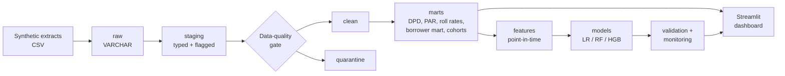
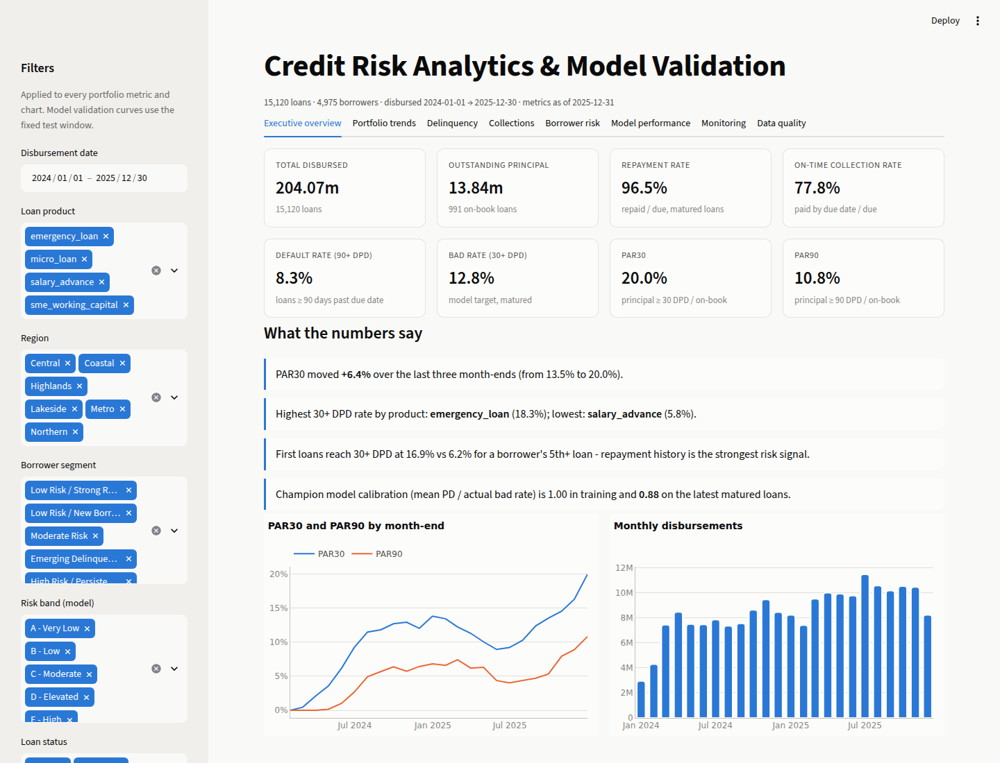

# Credit Risk Analytics & Lending Model Validation

An end-to-end, reproducible credit-risk analytics project for a short-term digital
lending portfolio: **raw lending data → SQL → borrower analytics → DPD / PAR /
collections → segmentation → point-in-time features → PD models → out-of-time
validation → actual-vs-predicted monitoring → dashboard**.

> **Synthetic data.** Every borrower, loan and transaction is generated by a documented
> simulation (`docs/assumptions.md`). No real lender, customer or production system is
> involved, and model results show the validation *process*, not real-world performance.
> This is a portfolio project, not an automated lending decision system.

---

## 1. Problem

A lending team needs to answer, from raw loan, repayment and wallet data:

- How is the book performing? (disbursements, collections, repayment rate, DPD, PAR,
  defaults, roll rates, vintages)
- Which borrowers are drifting into delinquency, and how do segments behave?
- Can we predict which new loans will reach 30 days past due - and does the model's
  predicted risk keep matching **actual outcomes** over time?
- Are the numbers trustworthy? (data quality, reproducibility, metric definitions,
  leakage)

## 2. Business context

Short-tenor (7-90 day), single-instalment digital loans - salary advances, micro loans,
emergency loans and SME working capital - disbursed to 4,975 borrowers between
January 2024 and December 2025 (15,120 loans, 204m disbursed, notional currency).
Borrowers also transact through a mobile wallet (792k transactions), which supplies
cash-flow features. A macro-stress episode from August 2025 raises risk in two regions:
PAR30 rises from **9.2% (Jun-2025) to 20.0% (Dec-2025)**, and the monitoring layer has
to detect the consequences for the model.

## 3. Architecture



DuckDB warehouse, SQL transformations in plain files, Python for orchestration,
validation, modeling and monitoring. Details and engineering decisions:
[`docs/architecture.md`](docs/architecture.md).

## 4. Dataset

Four raw extracts - `borrowers`, `loans`, `repayments`, `transactions` - with realistic
dependencies: a hidden creditworthiness trait, employment-driven income and volatility,
income shocks, behavioural memory (good repayment -> higher limits, lower risk),
partial / early / late payments, defaults with late recoveries, and right-censoring at the
2025-12-31 snapshot. Documented defects are injected (duplicates, orphans, swapped dates,
unit errors, label noise). [`docs/data-dictionary.md`](docs/data-dictionary.md),
[`docs/assumptions.md`](docs/assumptions.md).

## 5. SQL pipeline

49 SQL files across five layers - SQL is where the lending logic lives, not pandas:

| Layer | Files | Examples |
|---|---|---|
| `sql/staging` | 4 | `TRY_CAST` typing, label standardisation, two de-duplication patterns, robust outlier flags |
| `sql/clean` | 4 | Validity rules with quarantine tables and reason codes |
| `sql/marts` | 11 | Payoff via window sums, **ASOF joins** for month-end balances, fee→interest→principal waterfall, DPD, PAR, roll rates, vintages, borrower mart with segment rules |
| `sql/features` | 2 | Point-in-time features with an ASOF join on cumulative repayments |
| `sql/analytics` | 19 | Disbursement/collection trends, PAR by month, DPD distribution, roll-rate `PIVOT`, cohort vintages, recovery, FPD, actual vs predicted, risk-band performance |

Every analytics query and its output: [`reports/sql_analytics.md`](reports/sql_analytics.md).
Lineage and rules: [`docs/etl.md`](docs/etl.md).

## 6. Risk metrics

DPD (contractual, loan-level), DPD buckets aligned to PAR thresholds, PAR1/7/30/60/90
(outstanding principal, write-offs excluded from both sides), repayment / collection /
completion / early / late rates, maturity-adjusted default rate (90 DPD), bad rate
(30 DPD), FPD30, roll rates, recovery rate, collection efficiency by due cohort.
Formal dictionary with formula, grain, SQL and Python implementation for each:
[`docs/metrics.md`](docs/metrics.md). SQL and Python implementations are tested to agree.

## 7. Feature engineering

51 features in nine groups (application, profile, loan history, repayment behaviour,
delinquency, collections, wallet transactions, recency, stability), all computed **as of
the day before each decision**. A registry declares every model input; the leakage audit
combines a static SQL scan, a **truncation test** (features rebuilt from data truncated at
the decision date must match exactly) and a negative control proving the test catches a
planted leak. [`docs/feature-engineering.md`](docs/feature-engineering.md),
[`reports/leakage_audit.md`](reports/leakage_audit.md).

## 8. Modeling

Target `bad_30dpd` (loan reaches 30 DPD), out-of-time split (train ≤ Mar-2025,
validation Q2, test Q3, recent Q4 matured). Logistic Regression, Random Forest and
HistGradientBoosting are tuned on validation; a parsimony rule keeps the interpretable
baseline unless a challenger wins by > 0.01 AUC. PD → score (600 at 50:1, PDO 20) →
analytical risk bands A-E. Gender, age and region are excluded and used only for a
fairness review. [`docs/modeling.md`](docs/modeling.md).

## 9. Validation - results (synthetic, seed 42)

| Model | Train AUC | Validation AUC | Test AUC | Recent AUC |
|---|---|---|---|---|
| **Logistic Regression (champion)** | 0.785 | 0.777 | **0.784** | 0.764 |
| Random Forest | 0.853 | 0.766 | 0.779 | 0.768 |
| Hist Gradient Boosting | 0.853 | 0.764 | 0.782 | 0.770 |

- Tree models over-fit (train-validation gap ~0.09) without better out-of-time ranking.
- Champion, test window: Gini 0.57, KS 0.43, PR-AUC 0.39 vs a 14.4% bad rate; riskiest
  decile 46.8% actual bad rate vs 1.4% in the safest.
- **Actual vs predicted:** calibration ratio 1.00 (train) → 0.92 (test) → 0.88 (recent).
  Rank-ordering holds but the stress episode raised the risk *level*; score PSI stays
  stable (0.01), so only matured-outcome monitoring reveals it → recalibrate, don't
  rebuild.

Full report: [`reports/model_validation_report.md`](reports/model_validation_report.md)
(deciles, calibration, lift/gains, thresholds, explanations, fairness);
monitoring: [`reports/monitoring_report.md`](reports/monitoring_report.md);
segmentation: [`reports/segmentation_report.md`](reports/segmentation_report.md);
data quality: [`reports/data_quality_report.md`](reports/data_quality_report.md).

## 10. Dashboard

`make dashboard` → Streamlit app with eight tabs: executive overview (KPIs and
auto-generated insights), portfolio trends, delinquency (DPD mix, roll-rate heatmap),
collections, borrower risk (segments, risk bands, vintages, cohorts), model performance
(ROC/PR, calibration, deciles, lift/gains, importance, individual explanations,
fairness), monitoring and data quality. Filters for date, product, region, segment, risk
band and loan status recompute every portfolio metric from loan-level data using the same
tested metric functions. No number is hard-coded.



## 11. Testing

`make test` - 77 tests, ~1 minute:

- **Deterministic toy cases** for DPD, bucket boundaries, PAR (the 1,000 / 3,000 example),
  waterfall, write-off exclusion, rates, KS, score scaling, PSI - in Python *and* SQL.
- **Integration** on a freshly generated small portfolio: every injected defect detected
  exactly, clean-layer invariants, SQL = Python PAR for every month, borrower-mart
  aggregations, segment rule order, roll-rate conservation, all analytics queries.
- **Leakage:** truncation test, negative control, static scan, chronological splits.
- **Model:** valid probabilities, registry-only features, threshold chosen on validation,
  parsimony rule, every loan scored and banded, evaluation/monitoring outputs.
- **Dashboard:** Streamlit `AppTest` renders all tabs and re-filters without errors.

Lint (`ruff`), format and type-check (`mypy`, strict defs on `src/`) are clean.

## 12. Reproducibility

Requires Python 3.12+.

```bash
git clone <repo> && cd credit-risk-scoring
make setup          # venv + pip install -e ".[dev]"
make all            # generate -> validate -> etl -> segment -> features -> train -> evaluate -> monitor -> analytics (~80 s)
make dashboard      # http://localhost:8501
make test           # 77 tests
make lint typecheck
```

Individual stages: `make generate-data | validate | etl | segment | features | train |
evaluate | monitor | analytics | notebooks`. Configuration: `.env.example`
(no secrets needed). The generator is seeded, so reruns reproduce the committed reports.

Notebooks (`notebooks/01-04`) tell the story and import the package - no core logic lives
in them.

## 13. Limitations

Synthetic data; single-instalment loans; monthly roll rates; hindsight segments;
point-estimate fairness review; no automated recalibration; DuckDB-specific SQL
(`ASOF JOIN`, `PIVOT`). Full list: [`docs/limitations.md`](docs/limitations.md).

## 14. Future improvements

Instalment schedules with per-instalment DPD; automated recalibration with
champion-challenger; bootstrap confidence intervals for validation and fairness metrics;
forward-tested segments; dbt + PostgreSQL deployment; expected-loss (PD × LGD × EAD).

---

CV claim → evidence mapping and final status: [`docs/final-audit.md`](docs/final-audit.md).
