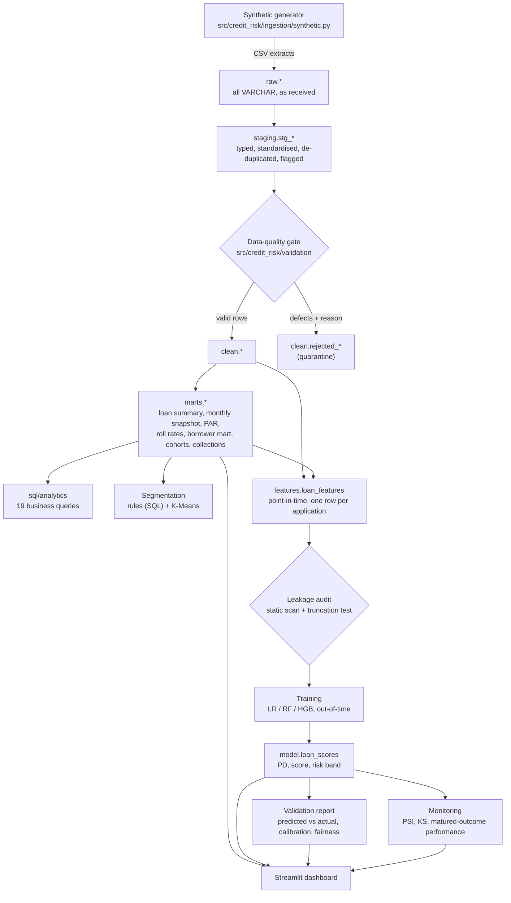

# Architecture

## Layers



Every arrow is a command in the `Makefile`; stages communicate only through the DuckDB
warehouse (`data/warehouse/credit_risk.duckdb`) and `artifacts/`, so any stage can be
re-run on its own.

| Stage | Command | Code | Output |
|---|---|---|---|
| Generate | `make generate-data` | `ingestion/synthetic.py` | `data/raw/*.csv`, `_manifest.json` |
| Validate | `make validate` | `ingestion/load_raw.py`, `sql/staging`, `sql/clean`, `validation/` | `raw`, `staging`, `clean`, `quality` schemas; `reports/data_quality_report.md` |
| ETL | `make etl` | `sql/marts` | `marts` schema |
| Segment | `make segment` | `segmentation/clustering.py` | `marts.borrower_clusters`; `reports/segmentation_report.md` |
| Features | `make features` | `sql/features`, `features/` | `features` schema; `reports/leakage_audit.md` |
| Train | `make train` | `modeling/train.py` | `artifacts/models/`, `model.loan_scores` |
| Evaluate | `make evaluate` | `modeling/evaluate.py` | `artifacts/evaluation/evaluation.json`; `reports/model_validation_report.md` |
| Monitor | `make monitor` | `monitoring/` | `monitoring` schema; `reports/monitoring_report.md` |
| Analytics | `make analytics` | `sql/analytics`, `analytics/sql_reports.py` | `artifacts/analytics/*.csv`; `reports/sql_analytics.md` |
| Dashboard | `make dashboard` | `dashboard/` | Streamlit app |

## Repository layout

```text
sql/
  staging/      typing, standardisation, de-duplication, DQ flags (4 files)
  clean/        quarantine rules -> clean.* and clean.rejected_* (4 files)
  marts/        loan / monthly / portfolio / borrower / cohort marts (11 files)
  features/     point-in-time features and model dataset (2 files)
  analytics/    readable business queries (19 files)
src/credit_risk/
  config.py     every business rule and threshold in one place
  db.py         DuckDB session: schemas, variables, shared macros, SQL runner
  ingestion/    synthetic generator, raw loader
  validation/   declarative checks, runner, report
  transformations/  SQL layer orchestration
  analytics/    Python metric implementations, SQL report runner
  segmentation/ K-Means vs rule segments
  features/     registry, leakage tests, audit report
  modeling/     pipelines, training, metrics, scorecard, explainability, fairness, evaluation
  monitoring/   PSI/KS drift, performance-over-time
  reporting/    Markdown helpers
dashboard/      Streamlit app (loaders, theme, app)
tests/          toy-case, SQL, integration, leakage and dashboard tests
notebooks/      storytelling notebooks (import the package; no core logic)
reports/        generated, committed Markdown reports
docs/           this documentation
```

## Engineering decisions

| Decision | Why | Alternatives considered | Trade-off |
|---|---|---|---|
| **DuckDB** as the warehouse | Zero-setup, file-based, fast columnar SQL; a reviewer can reproduce everything with `pip install`. Supports window functions, `FILTER`, `ASOF JOIN`, `PIVOT`, macros and session variables. | PostgreSQL via Docker Compose | SQL uses a few DuckDB idioms (`ASOF JOIN`, `GROUP BY ALL`, `getvariable`). Porting to Postgres needs lateral joins instead of `ASOF` - see `docs/limitations.md`. |
| **Transformations in SQL files**, orchestrated by Python | SQL is the lingua franca of analytics teams and reviewable in isolation; Python adds orchestration, testing and modeling. | dbt | dbt would add a dependency and project structure for ~20 models; plain ordered files keep the lineage obvious. The layering mirrors dbt conventions (staging -> marts). |
| **Business parameters injected as DuckDB variables and macros** generated from `config.py` | One definition of snapshot date, tolerances, DPD buckets, default/write-off thresholds for SQL *and* Python. | Hard-coding in SQL | Slightly less "pure" SQL files; far less definition drift. |
| **Raw layer is all VARCHAR** | Casting failures become visible data-quality findings instead of load errors; raw is an immutable copy. | Typed CSV load | More casting code in staging. |
| **Quarantine instead of delete** | Rejected rows are kept with reason codes for the source owner; retention rate is reported. | Silent filtering | Extra tables. |
| **Features computed in SQL, as of decision date - 1** | Point-in-time logic is explicit and testable (truncation test); SQL shows the extraction skill directly. | pandas feature code | Complex SQL; mitigated by CTE structure and tests. |
| **Logistic regression champion via parsimony rule** | Interpretable, stable out-of-time, calibrated; challengers must beat it by > 0.01 AUC. | Pick the highest AUC | Might leave a sliver of AUC on the table; gains explainability and stability. |
| **No SHAP / XGBoost** | Permutation importance and baseline-substitution explanations cover the need with scikit-learn only. HGB is scikit-learn's gradient boosting. | SHAP, XGBoost, LightGBM | Heavier dependencies and platform wheels for no demonstrated gain on this data. |
| **Streamlit + Plotly** | Data-science-native, fast to review, no frontend build. | React / Next.js | Less layout control; acceptable for an analytical tool. |
| **No Docker** | Nothing needs a server: Python 3.12 + pip reproduces the project. | Docker Compose with Postgres | Adds friction without adding evidence. |
